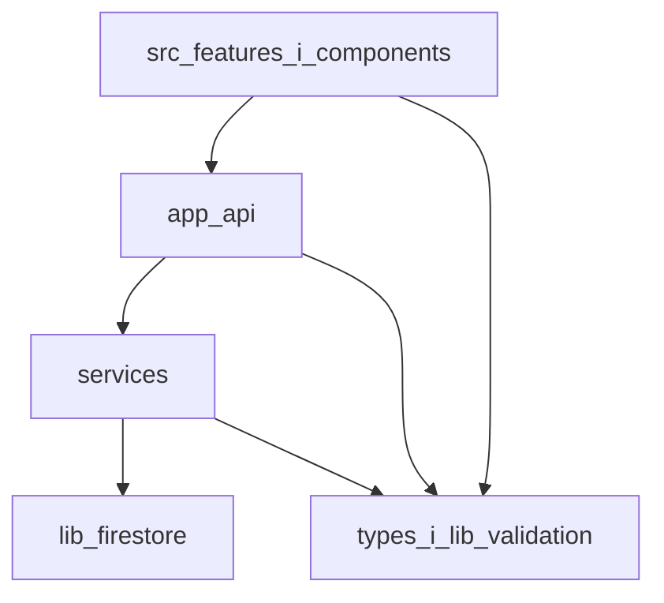

# Plan refaktoryzacji Second Brain

Analiza read-only (9 listopada 2026). Katalog `.worktrees/` pominięty. Sekrety z `.env` nie były otwierane.

## 1. Podsumowanie

Aplikacja jest już na Next.js 14 (App Router): `dev` i `build` w [`package.json`](../../package.json) wołają `next`, a [`tsconfig.json`](../../tsconfig.json) i [`next.config.mjs`](../../next.config.mjs) są konfiguracją Nexta (React 19, TypeScript, Tailwind 4, Firebase, TipTap, Zod). Warstwa HTTP jest w większości cienka: 22 z 24 tras używa `getAuthUserId`, a UI nie importuje Firestore. Serwisy CRUD są jednak prawie przezroczystymi wrapperami na monolit [`lib/firestore-db.ts`](../../lib/firestore-db.ts) (869 linii), a reguły domenowe i schematy siedzą w route handlerach oraz w komponentach. Największy koszt utrzymania to [`src/features/mind-maps/MindMapsTab.tsx`](../../src/features/mind-maps/MindMapsTab.tsx) (2224 linie) oraz niespójne typy Task / Note / CalendarEvent / Tag. Drzewo robocze na `feature/ollama-agent` miesza niezacommitowany rollback agenta i Plan AI ze zmianami map myśli, zadań i landingu. Testy jednostkowe na tym drzewie: **42 pliki, 266 testów, 0 niezaliczonych** (`npm run test:run`, Vitest 3.2.4). Integracja i Playwright nie były uruchamiane.

Pięć największych problemów: brudne drzewo gita jako fałszywa baza refaktoru; monolit Firestore i cienkie serwisy wbrew [ADR-014](../adr/014-layer-separation-and-service-layer.md); pliki UI powyżej granicy z [ADR-019](../adr/019-refaktoryzacja-dużych-plików-frontend.md); duplikaty typów, w tym rozjazd `task_deadline`; martwy entry Vite obok żywego `App.tsx`.

## 2. Stan wyjściowy

**Git.** Branch `feature/ollama-agent`, HEAD `7f9661b` (`docs(agent): document local Ollama agent setup`). Commity od `771851a` do `7f9661b` **dodają** agenta Ollama. W drzewie roboczym, bez commita: 67 ścieżek, +1174 / −3236. Usunięte m.in. `app/api/agent/*`, `app/api/plan/ask/route.ts`, `services/agent/*`, `services/agentService.ts`, `services/planService.ts`, `lib/ollama.ts`, `lib/gemini.ts`, `lib/agent/*`, `lib/dateRef.ts`, `src/components/AgentPendingActions.tsx` oraz ich testy. Razem z tym zaktualizowano [`README.md`](../../README.md), [`.env.example`](../../.env.example) (zniknęły `OLLAMA_*`) i komentarz w [`firestore.rules`](../../firestore.rules) (linia 4: „Retired agent_log”). Logika reguły (`document[0] != 'agent_log'`) została. Nieśledzony [`docs/superpowers/plans/2026-11-09-ollama-agent-chat.md`](../superpowers/plans/2026-11-09-ollama-agent-chat.md) nadal opisuje **dodanie** tego modułu.

Wniosek: usunięcie wygląda na świadomy rollback w drzewie roboczym (kod, testy, README, env, komentarz reguł idą razem; po nim `npm run test:run` przechodzi i nie ma wiszących importów `ollama` / `planService` / `agentService`). Historia brancha i nieśledzony plan mówią odwrotnie. To nie jest decyzja zapisana commitem. Blokada dla każdej fazy, która przywraca agenta albo dalej czyści `agent_log`, Gemini i Plan AI.

To samo drzewo zawiera osobne zmiany produktowe, nie refaktor: scalenie sekcji landingu (usunięte `BeforeAfter.tsx`, `HowItWorks.tsx`, `Problem.tsx`), skrócenie [`PlanowanieView.tsx`](../../src/features/planowanie/PlanowanieView.tsx) o pasek Plan AI oraz rozpoczęty podział map myśli (nieśledzone `mindMapAutosave.ts`, `mindMapHistory.ts`, `mindMapLayout.ts`, `mindMapNav.ts`, `useMindMapDocument.ts` i ich testy). [`src/features/mind-maps/MindMapsTab.tsx`](../../src/features/mind-maps/MindMapsTab.tsx) linie 39–40 już z nich korzystają.

**Testy.** Jednostkowe: 42 pliki, 266 zaliczonych, 0 niezaliczonych. Stderr z oczekiwanych błędów w teście uploadu i ostrzeżenie atrybutu `jsx` w teście NoteEditor. Nie uruchamiano `test:integration` ani `test:e2e`. `npm run prune` (`ts-prune`) daje dużo fałszywych trafień (eksporty route handlerów Nexta, typy „used in module”, pliki `.next/types`). Lista do usunięcia jest niżej, po ręcznym sprawdzeniu wywołań.

**Stack zweryfikowany.** Next 14.2, React 19, `strict: false` w [`tsconfig.json`](../../tsconfig.json) linia 17. Alias `@/*` → root. Vitest wyklucza `tests/integration`, `tests/e2e`, `dist`, `.worktrees` ([`vitest.config.ts`](../../vitest.config.ts) linie 10–16). Husky ([`.husky/pre-commit`](../../.husky/pre-commit)) odpala tylko Prettier przez lint-staged. ESLint: `next/core-web-vitals` + Prettier ([`.eslintrc.json`](../../.eslintrc.json)).

## 3. Znaleziska

| ID  | obszar         | problem                                                                                                               | dowód (plik:linia)                                                                                                                                                                                                                                                                                                                                                                                                                                                                                                                                                                          | wpływ                                                                                                                   | ryzyko                                                                                                               |
| --- | -------------- | --------------------------------------------------------------------------------------------------------------------- | ------------------------------------------------------------------------------------------------------------------------------------------------------------------------------------------------------------------------------------------------------------------------------------------------------------------------------------------------------------------------------------------------------------------------------------------------------------------------------------------------------------------------------------------------------------------------------------------- | ----------------------------------------------------------------------------------------------------------------------- | -------------------------------------------------------------------------------------------------------------------- |
| F01 | git            | Rollback agenta i Plan AI jest tylko w drzewie roboczym, w mieszance z innymi zmianami.                               | HEAD `7f9661b`; diff bez commita usuwa `services/planService.ts` i `lib/gemini.ts`; plan agenta zostaje jako plik nieśledzony.                                                                                                                                                                                                                                                                                                                                                                                                                                                              | Każdy refaktor oparty na złym drzewie utrwali albo cofnie produkt.                                                      | Wysokie. Blokada faz dotyczących AI.                                                                                 |
| F02 | Vite           | Martwy entry Vite stoi obok żywego shella Nexta.                                                                      | [`app/(protected)/dashboard/page.tsx`](<../../app/(protected)/dashboard/page.tsx>):3 importuje [`src/App.tsx`](../../src/App.tsx). [`src/main.tsx`](../../src/main.tsx):3 i [`src/index.css`](../../src/index.css) nie mają innych importerów. [`src/vite-env.d.ts`](../../src/vite-env.d.ts):1 wskazuje `vite/client`, a `vite` nie jest w `package.json`. `dist/` jest w [`.gitignore`](../../.gitignore):4. Brak `vite.config.*`.                                                                                                                                                        | `tsc` obejmuje `vite-env.d.ts` (`include` w tsconfig:23). `dist/` myli przegląd.                                        | Niskie dla `main.tsx` / `vite-env.d.ts` / `index.css` / lokalnego `dist/`. Wysokie, gdyby usunąć `App.tsx`.          |
| F03 | UI             | `MindMapsTab` dalej trzyma edytor i cztery modale. Wydzielenie hooków już się zaczęło i nie jest zacommitowane.       | Funkcje w pliku: `MindMapList` 275, `MindMapEditor` 386, `ExportSubtreeToMapModal` 1319, `MindMapDeleteModal` 1497, `MindMapAIModal` 1575, `MindMapAIImportTreeModal` 1710, `MindMapImportModal` 1941. `eslint-disable react-hooks/exhaustive-deps` w linii 447.                                                                                                                                                                                                                                                                                                                            | Zmiana w jednym pliku psuje nawigację, zapis i AI naraz.                                                                | Średnie. Testy nowych modułów już są; samego `MindMapsTab` nie ma.                                                   |
| F04 | UI             | Kolejne duże pliki po ADR-019 znowu urosły albo nigdy nie zeszły.                                                     | `MindMapTree.tsx` 741 (`NodePill` od 379, `TreeLevel` od 277). `mindMapExportHtml.ts` 559 (`buildHTMLExport` od 18). `TasksSection.tsx` 601 (od 54). `CalendarView.tsx` 465 (od 38). `NoteEditor.tsx` 444 (`FontSize` od 27, komponent od 224). `useResources.ts` 427 (od 130) — ścieżka to `src/components/resources/useResources.ts`.                                                                                                                                                                                                                                                     | Trudny przegląd i testy.                                                                                                | NoteEditor ma 16 testów. CalendarView, TasksSection, useResources i eksport HTML nie mają testu komponentu.          |
| F05 | warstwy        | Serwisy CRUD nie trzymają reguł, a część reguł jest w routach.                                                        | [`services/taskService.ts`](../../services/taskService.ts):4–6 przekazują wywołanie do `firestore-db`. [`app/api/calendar/events/route.ts`](../../app/api/calendar/events/route.ts):40–44 sprawdzają wielokrotność 15 minut. [`app/api/tasks/[id]/route.ts`](../../app/api/tasks/[id]/route.ts):28–33 walidują kolor i `pinned`.                                                                                                                                                                                                                                                            | Testy serwisu nie łapią reguł, które żyją tylko w HTTP.                                                                 | Średnie przy przenoszeniu, jeśli testy API zostaną uruchomione przed i po.                                           |
| F06 | warstwy        | API i serwisy importują kod z UI.                                                                                     | [`app/api/tasks/[id]/route.ts`](../../app/api/tasks/[id]/route.ts):4: `parseTaskTitleColor` z `src/components/tasks/taskInputUtils`. [`app/api/resources/route.ts`](../../app/api/resources/route.ts):5: schemat Zod z `src/components/resources/resourceTypes`. `mindMapService` importuje typy z `src/features/mind-maps/mindMapTypes.ts`.                                                                                                                                                                                                                                                | Serwer zależy od drzewa Reacta. Przeniesienie komponentu psuje API.                                                     | Średnie. Da się przenieść moduły bez zmiany zachowania.                                                              |
| F07 | dane           | Trzy style zapisu Firestore.                                                                                          | Monolit `lib/firestore-db.ts`. `mindMapService` używa Admin SDK i tylko `mindMapsCol` (eksport linia 73). [`app/api/waitlist/route.ts`](../../app/api/waitlist/route.ts):2 bierze `getFirestore` bezpośrednio. [`lib/getAuth.ts`](../../lib/getAuth.ts):34–39 czyta kolekcję `waitlist` przy każdym żądaniu.                                                                                                                                                                                                                                                                                | Trudno podmienić dostęp do danych i objąć go jednym testem.                                                             | Waitlist jest publiczny z założenia. Nie łączyć tej zmiany z regułami bezpieczeństwa.                                |
| F08 | typy           | Typy domenowe są rozproszone. Katalog [`types/`](../../types/) jest pusty.                                            | `Task` w [`TasksSection.tsx`](../../src/components/TasksSection.tsx):14–27 i `TaskRecord` w `firestore-db.ts:548`. `Note` w [`useNotesData.ts`](../../src/features/notes/useNotesData.ts):3–8 i `NoteRecord` w linii 16. `CalendarEvent.type` obejmuje `task_deadline` w [`calendarUtils.ts`](../../src/components/calendar/calendarUtils.ts):9 i [`calendarService.ts`](../../services/calendarService.ts):15, a `CalendarEventRecord` w linii 56 ma tylko `work \| meeting`. [`ActivityLog.tsx`](../../src/components/ActivityLog.tsx):18–27 deklaruje własny `CalendarEvent` bez `type`. | Cicha utrata pola przy zapisie albo przy statystykach aktywności.                                                       | Ujednolicenie `task_deadline` może zmienić zachowanie. Osobny krok z testami `calendarService` (11 testów już jest). |
| F09 | walidacja      | Zod obejmuje mniejszość tras. `any` jest rzadkie.                                                                     | `parseBody` jest w [`lib/parseBody.ts`](../../lib/parseBody.ts). Używają go trasy mind-maps i resources (5 plików). Ręczne `request.json()` mają trasy tasks, task-templates, calendar, notes, tags i waitlist. `as any` w [`services/mindMapAIService.ts`](../../services/mindMapAIService.ts):165. Brak `@ts-ignore` i `@ts-expect-error` w kodzie produkcyjnym. `strict: false`.                                                                                                                                                                                                         | Niespójne błędy 400. `strict: false` ukrywa null.                                                                       | Włączanie `strict` hurtowo jest poza tym planem.                                                                     |
| F10 | bezpieczeństwo | Reguły są zgodne z modelem „dane pod `users/{uid}`”, a serwer i tak omija je Admin SDK.                               | [`firestore.rules`](../../firestore.rules):6–9: odczyt i zapis, gdy `request.auth.uid == userId`, z wyłączeniem `agent_log`. Trasy z `getAuthUserId` weryfikują Bearer przez `verifyIdToken` ([`lib/getAuth.ts`](../../lib/getAuth.ts):20). Bez auth: `POST /api/waitlist` i `GET /api/waitlist/check-email`. `GET /api/waitlist/check` auth ma.                                                                                                                                                                                                                                            | Klient nie importuje `firebase/firestore` (przeszukane `src/` i `app/(protected)/`). Reguły są drugą linią, nie jedyną. | Nie zmieniać logiki reguł w refaktorze. Zostawienie `agent_log` po rollbacku jest świadome do decyzji z F01.         |
| F11 | legacy         | SQLite i martwy odczyt chunków RAG. Zapis chunków nadal żyje.                                                         | `brain.db` jest w `.gitignore:19`. `better-sqlite3` jest tylko w [`scripts/migrate-sqlite-to-firestore.ts`](../../scripts/migrate-sqlite-to-firestore.ts). `getChunksForSearch` (linia 387), `getResourcesByNoteFromFirestore` (349) i `_deleteResourceFromNoteFirestore` (371) nie mają wywołań poza definicją. [`services/documentService.ts`](../../services/documentService.ts):14 nadal woła `addChunks`. Panel dokumentów woła `/api/documents` i `/api/upload` ([`DocumentsPanel.tsx`](../../src/components/resources/DocumentsPanel.tsx):26, 46).                                   | Martwy odczyt RAG myli podział `firestore-db`. Usunięcie zapisu chunków zmieniłoby dane.                                | Kasować tylko funkcje bez wywołań. Zapis chunków i `brain.db` czekają na właściciela.                                |
| F12 | zależności     | Część bibliotek nie ma importu w kodzie aplikacji. `nanoid` jest używany, a nie jest w `package.json`.                | Brak importu `@xyflow/react`, `d3-force` i `react-markdown` w `*.ts`/`*.tsx` (poza `package.json` i dokumentami). XYFlow jest w planie [`docs/superpowers/plans/2026-11-08-tablica-plotno.md`](../superpowers/plans/2026-11-08-tablica-plotno.md) i na branchu `feat/tablica-plotno`. `nanoid` jest importowany w `MindMapsTab.tsx:23` i `mindMapAIService.ts:3`; katalog `node_modules/nanoid` istnieje jako zależność przechodnia.                                                                                                                                                        | `react-markdown` można zdjąć. XYFlow i d3 zostawić do decyzji o tablicy. `nanoid` może zniknąć przy `npm update`.       | Średnie, gdyby usunąć XYFlow w trakcie prac nad tablicą.                                                             |
| F13 | i18n           | Landing i część błędów map myśli są na sztywno po polsku. Aplikacja ma słownik en/pl.                                 | [`src/translations.ts`](../../src/translations.ts): 499 linii, `en` od linii 7, `pl` od 252. Landing nie importuje `translations` (m.in. [`Hero.tsx`](../../src/components/landing/Hero.tsx):13). Błąd AI: `MindMapsTab.tsx:1614` (`Nie udało się pobrać odpowiedzi AI.`), także 1619 i 1624.                                                                                                                                                                                                                                                                                               | Landing jest jednojęzyczny przy dwujęzycznym dashboardzie.                                                              | Przeniesienie landingu do i18n zmienia sposób edycji copy. Poza refaktorem, dopóki właściciel tego nie chce.         |
| F14 | testy          | Duże pliki, które plan tnie, nie mają testu charakteryzującego. Osieroconych testów agenta w drzewie roboczym nie ma. | Jest: serwisy (w tym task, calendar, mind map, document), API tasks/notes/upload/templates, `NoteEditor` (16), utilsy zadań, nowe testy `tests/unit/features/mind-maps/*`. Nie ma pliku testowego dla `MindMapsTab`, `CalendarView`, `TasksSection`, `useResources`, `mindMapExportHtml`, `firestore-db`. Fixture `tests/fixtures/gemini-response.json` nie jest importowany z kodu testów.                                                                                                                                                                                                 | Podział bez testu opiera się na ręcznym klikaniu.                                                                       | Dopisać cienkie testy przed cięciem, nie zamiast cięcia.                                                             |
| F15 | wydajność      | Ciężkie biblioteki wchodzą do bundla dashboardu statycznym importem.                                                  | TipTap: [`NoteEditor.tsx`](../../src/components/NoteEditor.tsx):4–12, a `MindMapsTab` importuje `NoteEditor` statycznie (linia 41). Recharts: [`ActivityLog.tsx`](../../src/components/ActivityLog.tsx):2–11, importowane z góry w [`PlanowanieView.tsx`](../../src/features/planowanie/PlanowanieView.tsx):15. Brak `next/dynamic` w `src/`. XYFlow do bundla nie wchodzi, bo nie ma importu.                                                                                                                                                                                              | Większy JS przy pierwszym wejściu w dashboard, także na zakładce, która edytora nie otwiera.                            | Dynamiczny import dodaje stan ładowania. Robić po podziale plików i sprawdzić, że widok końcowy jest ten sam.        |
| F16 | DX             | `ts-prune` nie nadaje się jako lista kasowania. Pusty katalog `features/` w rootcie.                                  | Fałszywe trafienia: default exporty stron, `GET`/`POST` route handlerów, [`src/features/planowanie/index.ts`](../../src/features/planowanie/index.ts) (brak importera, ale to barrel). Nieużywane eksporty potwierdzone ręcznie: F11 oraz `isFirestoreConfigured` ([`lib/firebase-admin.ts`](../../lib/firebase-admin.ts):52) i `isFirebaseConfigured` ([`src/lib/firebase-client.ts`](../../src/lib/firebase-client.ts):46).                                                                                                                                                               | Ktoś może skasować route, bo prune tak napisał.                                                                         | Usuwać tylko pozycje z ręcznym grepem „brak wywołań”.                                                                |

`lib/` i `src/lib/` nie dublują plików. `lib/` to serwer (Admin, Firestore, błędy, `parseBody`). `src/lib/` to klient (`firebase-client`, `auth/useAuth`, `cn`, `activeSession`, `mindMapUtils`). Nakładanie się dotyczy Firebase (dwa SDK, świadomie) i map myśli (utils w UI, kolekcja w `firestore-db`).

## 4. Docelowa architektura

Bez zmiany stacku i bez migracji z Firestore. Kontrakt z ADR-014, dopasowany do kodu, który naprawdę jest:

- UI woła wyłącznie `/api/*` przez `apiFetch`. Bez Firestore w komponentach. Ten warunek już jest spełniony i ma taki zostać.
- Route handler: auth, `parseBody`, jedno wywołanie serwisu, `handleServiceError`. Reguła „duration % 15” i walidacja koloru zadania schodzą do serwisu.
- Serwis zna typy z `types/`, nie komponenty Reacta.
- `lib/firestore/` to pliki per kolekcja. [`lib/firestore-db.ts`](../../lib/firestore-db.ts) zostaje jako barrel, żeby mocki w testach (`vi.mock("@/lib/firestore-db")`) nie wymagały przepisywania.
- Schematy Zod i czyste funkcje współdzielone przez API i UI (`parseTaskTitleColor`, schematy zasobów, typy map myśli) lądują w `types/` albo `lib/validation/`, poza plikami `.tsx`.
- `src/lib/` zostaje dla kodu przeglądarki.
- Puste `features/` w rootcie znika. Puste `types/` staje się miejscem na typy domenowe.
- `src/App.tsx` zostaje. Martwe są tylko `src/main.tsx`, `src/vite-env.d.ts`, `src/index.css`.

Podział dużych plików, bez zmiany zachowania:

- `MindMapsTab.tsx`: osobne pliki na `MindMapList`, `MindMapEditor`, każdy modal. Wspólne stałe paneli notatek i `clamp` (dziś zdublowany z `MindMapTree.tsx` linia 30 i `MindMapsTab.tsx` linia 52) do małego modułu. `MindMapEditor` (~930 linii) w drugim kroku: pasek narzędzi, skróty, panel notatek.
- `MindMapTree.tsx`: `NodePill` i `TreeLevel` do sąsiednich plików. Zostawić test [`tests/unit/features/mind-maps/MindMapTree.labelEdit.test.tsx`](../../tests/unit/features/mind-maps/MindMapTree.labelEdit.test.tsx).
- `mindMapExportHtml.ts`: przenieść szablon HTML do osobnego pliku, API `exportHTML` / `buildHTMLExport` zostaje. Najpierw test snapshotu wyjścia, bo dziś go nie ma.
- `firestore-db.ts`: `documents`, `notes`, `chunks`, `resources`, `calendar`, `tasks`, `tags`, `taskTemplates`, typy na górze do `types/`. Barrel re-eksportuje dotychczasowe nazwy.
- `TasksSection.tsx`: hook `useTasksBoard` (fetch, drag, search, szablony). Czysta logika już jest w `taskInputUtils` i `taskOrderUtils` i ma testy.
- `CalendarView.tsx`: hook danych miesiąca. `calendarUtils` i `CalendarDayColumn` już są i zostają.
- `NoteEditor.tsx`: `noteEditorExtensions.ts` (`FontSize`) i `NoteEditorToolbar.tsx`. Testy NoteEditor są warunkiem wejścia, nie dopiskiem po fakcie.
- `useResources.ts`: ciąć dopiero po teście hooka z mockiem `apiFetch`. ADR-019 już rozbił UI.

## 5. Plan etapowy

Każda faza to osobny, odwracalny commit po decyzji z F01. Refaktor nie zmienia tego, co widzi użytkownik. Zmiany już obecne w drzewie (agent, landing, Plan AI) nie są „fazą refaktoru” — właściciel commituje je albo je cofa zanim ruszy faza 1.

### Faza 0 — decyzja i czyste drzewo

- Cel: ustalić źródło prawdy i oddzielić zmiany produktowe od refaktoru.
- Kroki: właściciel wybiera stan agenta (zostawić rollback albo wrócić do HEAD). Zmiany produktowe (agent, landing, zadania, mapy) trafiają do osobnych commitów albo są zrewertowane. Ten plan nie wykonuje tych commitów.
- Warunek: brak fazy kodu na mieszanym drzewie.
- Testy: ponowić `npm run test:run` na wybranym stanie. Zapisać nową liczbę, jeśli różni się od 266.
- Ukończenie: `git status` czysty albo zawiera tylko świadomie odłożoną pracę, nazwaną w commicie.
- Ryzyko: utrata niezacommitowanej pracy przy resecie. Wycofanie: brak resetu bez kopii; commit albo `git stash`.

### Faza 1 — martwy kod, które da się udowodnić

- Cel: usunąć entry Vite i eksporty bez wywołań.
- Zakres: skasować `src/main.tsx`, `src/vite-env.d.ts`, `src/index.css`, lokalny `dist/` (`npm run clean` już robi `rm -rf dist .next`). Skasować puste `features/` w rootcie. Skasować eksporty z F11 i F16, które nie mają wywołań: `getResourcesByNoteFromFirestore`, `_deleteResourceFromNoteFirestore`, `getChunksForSearch`, `isFirestoreConfigured`, `isFirebaseConfigured`. Dodać `nanoid` do `dependencies`, skoro kod go importuje. Zdjąć `react-markdown`, jeśli grep nadal nie znajdzie importu.
- Poza zakresem: `src/App.tsx`, `@xyflow/react`, `d3-force`, `@types/d3-force`, `addChunks`, `documentService`, `brain.db`, skrypt migracji, fixture Gemini (osobna decyzja, czy RAG wraca).
- Testy przed i po: `npm run test:run`. Dodatkowo `npx tsc --noEmit` po usunięciu `vite-env.d.ts`, bo dziś ten plik jest w `include`.
- Ukończenie: dashboard nadal importuje `App`. Brak referencji do usuniętych symboli.
- Ryzyko: niskie. Wycofanie: revert commita. `dist/` i `.next` wracają przy następnym buildzie.

### Faza 2 — testy przed cięciem

- Cel: mieć siatkę na pliki z F04 i F14.
- Kroki, każdy osobno: snapshot `buildHTMLExport` na jednej małej mapie; render `CalendarView` z mockiem `apiFetch` (nawigacja miesiąca, brak wywołania POST przy złym kroku 15 minut zostaje po stronie API); render `TasksSection` sprawdzający, że kolumny korzystają z `taskOrderUtils` (logika już pokryta); test `useResources` na `handleAdd` z mockiem fetch.
- Warunek: faza 0. Faza 1 może iść równolegle, bo nie rusza tych plików.
- Ukończenie: nowe testy przechodzą na kodzie sprzed podziału.
- Ryzyko: testy zbyt mocno związane z markupem. Pisać na role i na wywołania `apiFetch`, nie na klasy Tailwind.
- Wycofanie: revert plików testów.

### Faza 3 — mapy myśli

- Cel: dokończyć podział już rozpoczęty w nieśledzonych plikach.
- Kroki: przenieść modale i `MindMapList` do `src/features/mind-maps/`; potem rozciąć `MindMapEditor`; potem `NodePill` i `TreeLevel`; na końcu szablon HTML.
- Warunek: faza 2 dla eksportu HTML. Testy `mindMapAutosave`, `mindMapHistory`, `mindMapLayout`, `mindMapNav`, `useMindMapDocument`, `MindMapTree.labelEdit` muszą przechodzić przed pierwszym ruchem.
- Testy po każdym kroku: te same pliki plus `npm run test:run`. Integrację `mindMapService` uruchomić raz na końcu fazy (`npm run test:integration`), jeśli emulator jest dostępny. Gdy nie jest, zapisać to w commicie jako niezweryfikowane.
- Ukończenie: `MindMapsTab.tsx` składa widok z importów i ma poniżej ok. 250 linii. Zachowanie zapisu, undo i AI bez zmian.
- Ryzyko: reset stanu przy autosave (komentarz w liniach 462–465). Nie zmieniać tablicy zależności efektu na `map.id`. Wycofanie: revert commita kroku.

### Faza 4 — NoteEditor, zadania, kalendarz

- Cel: te same cięcia, które opisuje sekcja 4, po jednym pliku na commit.
- Kolejność: NoteEditor (testy już są), potem `useTasksBoard`, potem `useCalendarData`. `useResources` tylko gdy test z fazy 2 jest zielony.
- Warunek: faza 2. Nie zależy od fazy 3.
- Testy: istniejące NoteEditor, taskInputUtils, taskOrderUtils, TaskColumn, TaskDetailModal, calendarService oraz nowe testy z fazy 2.
- Ukończenie: publiczne propsy `TasksSection`, `CalendarView`, `NoteEditor`, `useResources` bez zmian.
- Ryzyko: zgubienie stanu drag-and-drop przy przenoszeniu hooka. Wycofanie: revert jednego pliku na commit.

### Faza 5 — typy

- Cel: jedno miejsce na kształt Task, Note, CalendarEvent, Tag, Resource, MindMap.
- Kroki: skopiować typy rekordów z `firestore-db.ts` do `types/` i re-eksportować ze starych ścieżek. Potem przepiąć importy UI. Rozjazd `task_deadline` rozstrzygnąć tak, jak robi to dziś `calendarService` (pole istnieje w odpowiedzi API), a `CalendarEventRecord` albo dopuszcza ten typ tylko w warstwie serwisu, albo dostaje go jawnie, jeśli zapis do Firestore go nie utrwala. To trzeba sprawdzić w `createCalendarEvent` przed zmianą typu, bo dziś record mówi `work | meeting`.
- Warunek: fazy 3–4 dla plików, które dostaną nowe importy. Można zacząć od typów serwera wcześniej.
- Testy: `calendarService`, `taskService`, API tasks.
- Ukończenie: `ActivityLog` używa wspólnego typu albo świadomie węższego typu widoku, nazwanego inaczej niż `CalendarEvent`.
- Ryzyko: zmiana serializacji eventu. Wycofanie: re-eksport starych nazw do czasu ostatniego kroku.

### Faza 6 — walidacja i reguły w serwisach

- Cel: route handler zostaje cienki.
- Kroki, trasa po trasie, zaczynając od tych z testami: tasks, tasks/[id], calendar/events. Schemat Zod obok `parseBody`. Przenieść „duration % 15” i walidację koloru do serwisu. Potem notes, tags, task-templates. Waitlist zostawić z ręcznym JSON albo dać mu osobny schemat bez `getAuth`.
- Jednocześnie przenieść `parseTaskTitleColor` i schematy zasobów z `src/components` do `lib/validation/` (albo `types/`), a UI i API importują stamtąd.
- Warunek: faza 5 dla typów użytych w schematach. Można zrobić sam przeniesienie `taskInputUtils` wcześniej, bo jest pokryty 20 testami.
- Testy przed i po: `tests/unit/api/tasks.test.ts`, `tasks-id.test.ts`, `calendarService.test.ts`, `taskInputUtils.test.ts`.
- Ukończenie: `app/api` nie importuje z `src/components`. Komunikaty 400 tych tras zostają te same (testy to pinują).
- Ryzyko: inny kształt błędu Zod niż dzisiejszy `{ error: string }`. Dopasować mapper, nie UI. Wycofanie: revert jednej trasy.

### Faza 7 — podział `firestore-db`

- Cel: pliki per domena i barrel o tej samej ścieżce importu.
- Kroki: wyciąć notes, tasks, calendar, tags, templates, resources, documents/chunks. Zostawić `getChunksForSearch` skasowany w fazie 1. `addChunks` zostaje przy `documentService`.
- Warunek: faza 5 (typy) i zielone testy serwisów, które mockują `@/lib/firestore-db`.
- Testy: cały `tests/unit/services` i `tests/unit/api`.
- Ukończenie: stary import `@/lib/firestore-db` działa. Plik barrel jest krótki.
- Ryzyko: cykl importów. Wycofanie: przywrócić monolit z barrela.

### Faza 8 — bundle

- Cel: TipTap i Recharts ładują się z zakładką, która ich używa.
- Kroki: `next/dynamic` dla `NoteEditor` w panelu notatek mapy i w `NotesPanel`; dla `ActivityLog` w `PlanowanieView`, gdy zakładka to aktywność. Zostawić ten sam markup po załadowaniu.
- Warunek: fazy 3 i 4, żeby dynamiczny import miał małą granicę.
- Testy: NoteEditor i Home/Planowanie, jeśli renderują te widoki. Ręcznie: przełączenie zakładek nie zmienia danych na ekranie.
- Ukończenie: pierwszy render zakładki zadań nie ściąga modułu TipTap. Sprawdzić logiem builda (`next build`), nie tylko opinią.
- Ryzyko: miganie pustego panelu. Dać krótki placeholder o tej samej wysokości. Wycofanie: przywrócić import statyczny.

### Faza 9 — tylko po decyzji właściciela

Osobne decyzje, nie część domyślnego refaktoru: los agenta i `lib/gemini.ts` (mind mapy dalej używają `@google/genai` w `mindMapAIService.ts` linia 163, więc usunięcie `lib/gemini.ts` nie wyłącza AI map); czy przestać zapisywać chunki; czy usunąć SQLite i `better-sqlite3`; czy zdjąć XYFlow i d3; czy landing wchodzi do `translations.ts`; czy włączać `strict` plik po pliku.

## 6. Kolejność i priorytety

Najpierw faza 0, bo reszta na mieszanym drzewie utrwali rollback albo go nadpisze. Potem faza 1: mały diff, łatwy revert, nie rusza zachowania dashboardu. Faza 2 jest przed cięciem, bo CalendarView, TasksSection, useResources i eksport HTML nie mają siatki, a ADR-015 każe testować logikę przed zmianą struktury. Fazy 3 i 4 są niezależne i mogą iść osobnymi commitami; mapy są pilniejsze, bo plik ma 2224 linie i podział już trwa. Typy (5) i walidacja (6) są przed podziałem Firestore (7), żeby nie przenosić dwóch kształtów `CalendarEvent` do nowych plików. Bundle (8) jest na końcu, bo `dynamic()` na pliku 2200 linii tylko ukrywa problem. `strict`, i18n landingu, SQLite i chunki nie wchodzą w tę kolejkę.

## 7. Czego nie ruszać

- Firestore jako baza, Firebase Auth, kształt kolekcji `users/{uid}/...`, logika [`firestore.rules`](../../firestore.rules).
- Publiczne trasy waitlist.
- `src/App.tsx` i przepływ `/dashboard` → `App` → `HomeView` / `PlanowanieView`.
- Widoczne zachowanie: układ zakładek, drag zadań, segmenty kalendarza przez północ, autosave mapy, treść landingu.
- Zależności `@xyflow/react`, `d3-force`, `@types/d3-force`, dopóki tablica z 8 listopada jest aktualna.
- Zapis dokumentów i chunków (`documentService`, `DocumentsPanel`) oraz plik `brain.db`.
- Moduł agenta, dopóki właściciel nie wybierze stanu z fazy 0.
- ADR-y w `docs/adr/` i katalog `.worktrees/`.
- Włączanie `strict` jednym commitem.
- Wyniki `ts-prune` bez ręcznego potwierdzenia braku wywołań.

Pomysły odłożone: repository pattern z ADR-014 (dopiero gdy mock `firestore-db` naprawdę przeszkadza), Provider dla zasobów (ADR-019 go odrzuca), osobny język landingu, analyzer bundla jako stały skrypt CI.

## 8. Otwarte pytania

1. Czy źródłem prawdy jest HEAD z agentem, czy drzewo robocze bez agenta, Plan AI i `lib/gemini.ts`? Mind mapy dalej wołają Gemini.
2. Czy niezacommitowane zmiany landingu, zadań i map myśli mają wejść jako osobne commity produktowe przed refaktorem?
3. Czy tablica (`feat/tablica-plotno`, plan z 8 listopada) zostaje? Od tego zależy XYFlow i d3.
4. Czy zapis chunków przy uploadzie dokumentu ma zostać, skoro `getChunksForSearch` nie ma wywołań?
5. Czy migracja SQLite jest zakończona i można wycofać skrypt oraz `better-sqlite3`? Pliku `brain.db` nie kasować z dysku w ramach refaktoru.
6. Czy landing ma zostać po polsku na sztywno?
7. Czy fixture `tests/fixtures/gemini-response.json` jest jeszcze potrzebny? W kodzie testów nie ma do niego importu.

## Weryfikacja użyta przy tym planie

- `git status`, `git log`, `git diff --stat` na `feature/ollama-agent`.
- Odczyt ADR-014, ADR-015, ADR-018, ADR-019, początku tech stacku i początku planu agenta.
- `npm run test:run`: 42 pliki, 266 testów, 0 niezaliczonych. Integracja i e2e nieuruchomione.
- `npm run prune` oraz ręczny grep wywołań dla pozycji uznanych za martwe.
- Nie uruchamiano `next build`, `next lint` ani `tsc --noEmit` (ten ostatni przy `incremental: true` zapisuje `tsconfig.tsbuildinfo`).
